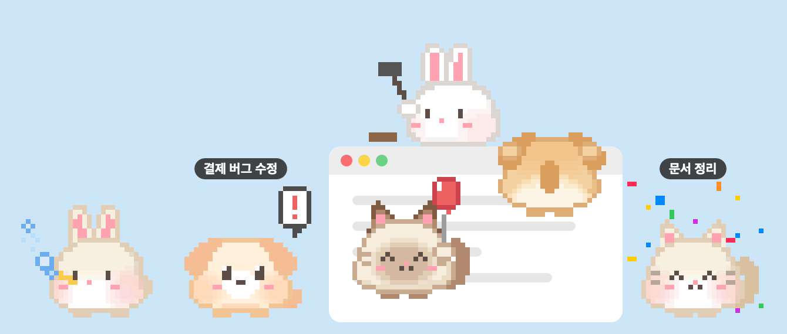
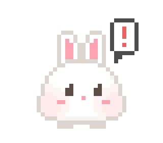
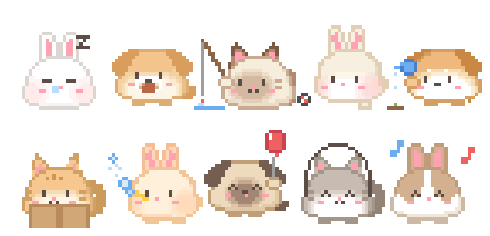
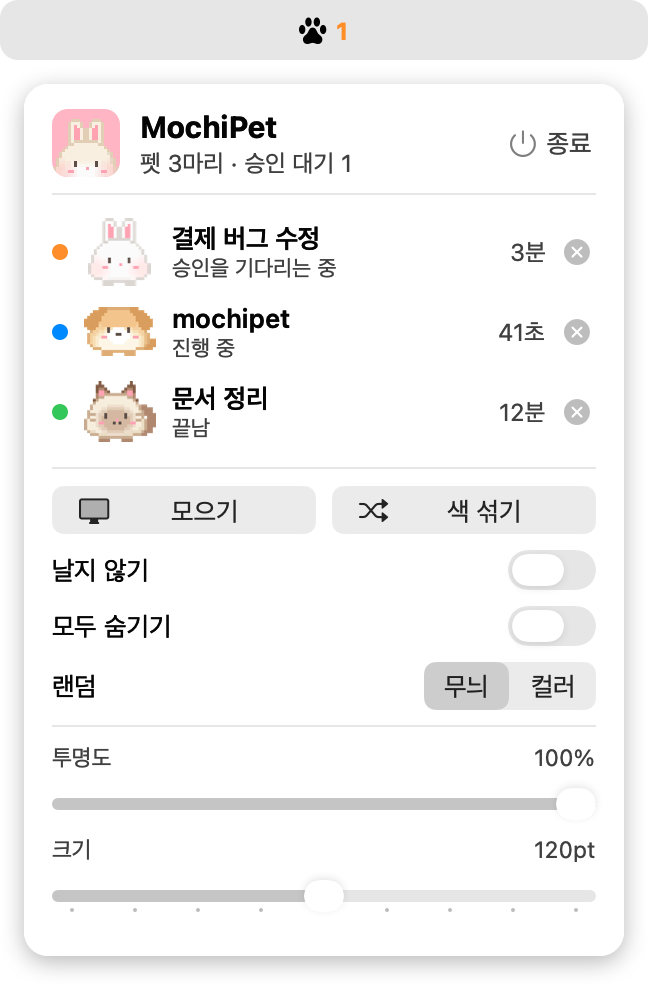
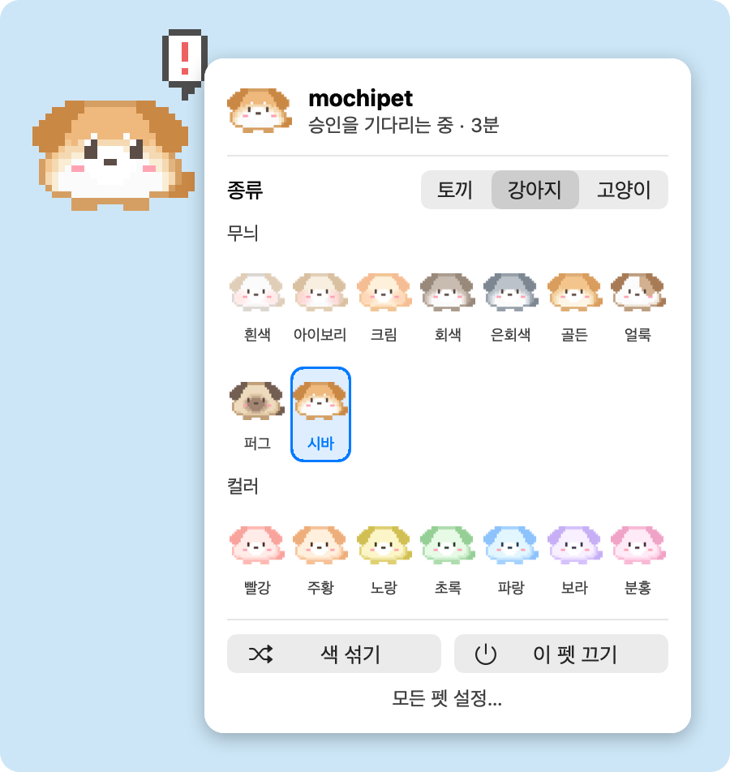
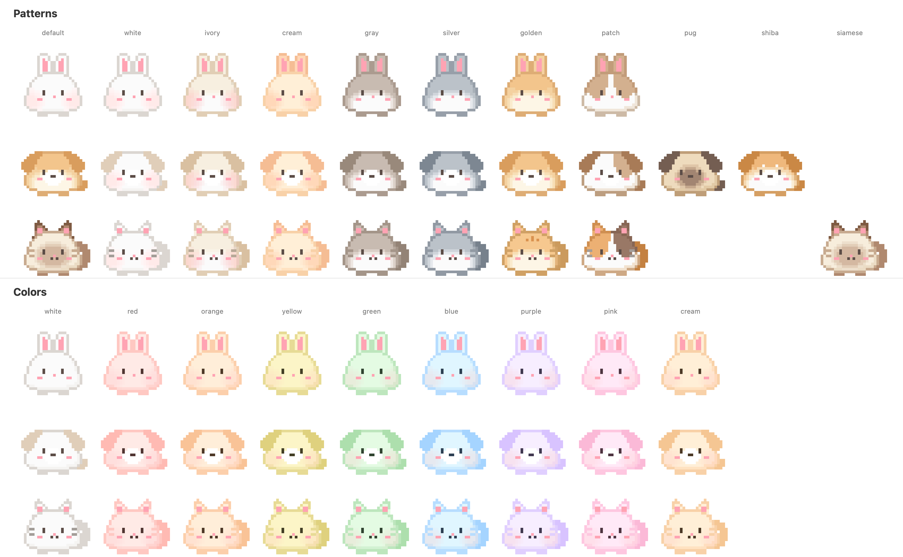

<div align="center">
  
  <h1>&nbsp;MochiPet</h1>
  <p>A macOS desktop pet that shows, with its body, whether a Claude Code session<br>is working, waiting for approval, or done.</p>
  <p>
    
    
    
    
  </p>
  <p><a href="README.md">한국어</a> · <b>English</b></p>
</div>

---

## Supported AI tools

- **Claude Code**: the `claude` CLI in a terminal. Click the pet to switch to that terminal app.
- **Claude Desktop**: sessions in the Code tab. Click the pet to open that session. The name tag shows the session title.

## Features

- **Session state at a glance**: the pet hammers while the session works, raises a `!` while a permission request waits, and jumps in confetti when the turn ends.
- **Jump to the session**: click the pet to switch to its session.
- **One pet per session**: each session where you run `/pet on` gets a pet with a name tag above its head.
- **Three pixel-art pets**: a bunny, a dog, and a cat, in patterns and colors.
- **A pet that plays alone**: with nothing to do it walks, sleeps, fishes, and rides a balloon. There are more than 40 actions.
- **Menu bar controls**: change opacity and size, keep pets on the ground, or hide them all.

## Install

macOS only. You need two things.

- Xcode Command Line Tools (`xcode-select --install`)
- Claude Desktop

There are two ways to install. Use only one. With both, the hooks run twice.

### Option 1. Plugin

Run the command below in a terminal. It needs Claude Code 2.1.275 or later.

```bash
claude plugin install mochipet --marketplace lyeongl/mochipet
```

- `/pet on` works from the next session you open. The first time, it takes 10–20 seconds to build the pet app.
- The five hooks and the `/pet` skill come with the plugin. `hooks` in `~/.claude/settings.json` is not changed.
- If you already installed with Option 2, run `./install.sh uninstall` first.

Update and remove it with the commands below.

```bash
claude plugin update mochipet@mochipet
```

```bash
claude plugin uninstall mochipet@mochipet
```

### Option 2. git clone

Use this if you don't have the `claude` command.

```bash
git clone https://github.com/lyeongl/mochipet.git
```

```bash
cd mochipet && ./install.sh
```

`install.sh` does the following.

1. Builds `MochiPet.app` inside this folder.
2. Puts the `/pet` skill in `~/.claude/skills/pet/`.
3. Adds five hooks to `hooks` in `~/.claude/settings.json`.
   - Your other hooks and settings are left alone.
   - The file as it was before is kept as `settings.json.pet-backup`.

The hooks point at the executable in this folder. If you move the folder, run `./install.sh` again.

To remove it, run the command below. It removes only this pet's hooks, skill, session state, and backup file.

```bash
./install.sh uninstall
```

## Usage

Type these in a Claude session.

| Command | What it does |
|---|---|
| `/pet on` | Turns on this session's pet. The kind and color are picked at random, avoiding the ones other pets already use |
| `/pet on session name` | Turns it on with a name tag. Without a name, the session title from Claude Desktop becomes the name tag |
| `/pet kind dog` | Changes the kind: `bunny`, `dog`, or `cat` |
| `/pet color` | Picks a new color at random |
| `/pet color pink` | Sets the color. The names are in the colors picture below |
| `/pet color default` | Goes back to the default color of that kind |
| `/pet name new session name` | Changes the name tag |
| `/pet off` | Turns the pet off |

## Screenshots

<table>
  <tr>
    <td align="center" colspan="2" width="33%"></td>
    <td align="center" colspan="2" width="33%"></td>
    <td align="center" colspan="2" width="33%"></td>
  </tr>
  <tr>
    <th align="center" colspan="2">Working</th>
    <th align="center" colspan="2">Waiting for approval</th>
    <th align="center" colspan="2">Done</th>
  </tr>
  <tr>
    <td align="center" colspan="6"></td>
  </tr>
  <tr>
    <th align="center" colspan="6">Idle</th>
  </tr>
  <tr>
    <td align="center" colspan="3"></td>
    <td align="center" colspan="3"></td>
  </tr>
  <tr>
    <th align="center" colspan="3">Menu bar</th>
    <th align="center" colspan="3">Right-click on a pet</th>
  </tr>
</table>

### Colors



- Pick a color with `/pet color <name>` or by right-clicking the pet. A number from 0 to 360 gives the color at that angle on the color wheel.

## License

[MIT](LICENSE)
