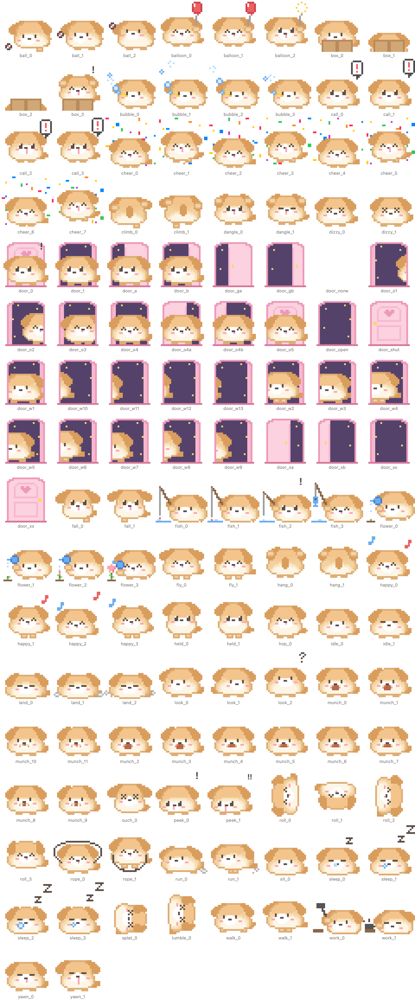
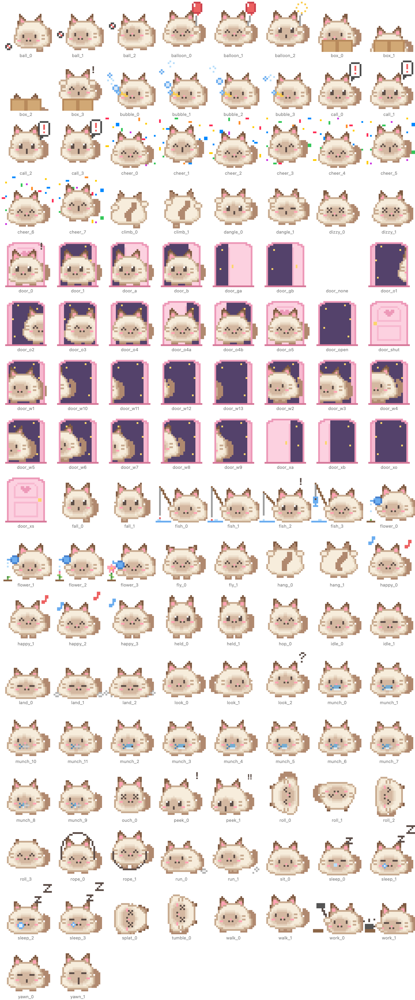

# MochiPet

[한국어](README.md) | English


A desktop pet for Code sessions in Claude Desktop.  
Make one with `/pet on`!

## The pet shows the session state

You can tell what Claude is doing from the pet alone, without looking at the session window.

| Working | Waiting for approval | Done |
|:---:|:---:|:---:|
|  |  |  |
| **Sits and hammers** | **Calls you with a `!`** | **Jumps in confetti** |
| Starts when you send a prompt<br>and goes on until the turn ends | Keeps calling while a permission request waits.<br>Hammers again once you approve | Jumps when the turn ends. Click the pet or<br>open that session and it goes back to playing |

Otherwise it plays alone: walks, sleeps, eats. Click the pet to open its session in Claude Desktop.

## Install

macOS only. You need two things.

- Xcode Command Line Tools (`xcode-select --install`)
- Claude Desktop

There are two ways to install. Use only one. With both, the hooks run twice.

### Option 1. Plugin

Run the command below in a terminal. It needs Claude Code 2.1.275 or later.

```bash
claude plugin install mochipet --marketplace lyeongl/mochipet
```

- `/pet on` works from the next session you open. The first time, it takes 10–20 seconds to build the pet app.
- The five hooks and the `/pet` skill come with the plugin. `hooks` in `~/.claude/settings.json` is not changed.
- If you already installed with Option 2, run `./install.sh uninstall` first.

Update and remove it with the commands below.

```bash
claude plugin update mochipet@mochipet
```

```bash
claude plugin uninstall mochipet@mochipet
```

### Option 2. git clone

Use this if you don't have the `claude` command or want to use your own art.

```bash
git clone https://github.com/lyeongl/mochipet.git
```

```bash
cd mochipet && ./install.sh
```

`install.sh` does the following.

1. Builds `MochiPet.app` inside this folder.
2. Puts the `/pet` skill in `~/.claude/skills/pet/`.
3. Adds five hooks to `hooks` in `~/.claude/settings.json`.
   - Your other hooks and settings are left alone.
   - The file as it was before is kept as `settings.json.pet-backup`.

The hooks point at the executable in this folder. If you move the folder, run `./install.sh` again.

To remove it, run the command below. It removes only this pet's hooks, skill, session state, and backup file.

```bash
./install.sh uninstall
```

## Usage

### Commands

Type these in a Claude session.

| Command | What it does |
|---|---|
| `/pet on` | Turns on this session's pet. The kind and color are picked at random, avoiding the ones other pets already use |
| `/pet on payment bug` | Turns it on with a name tag. Without a name, the session title from Claude Desktop becomes the name tag |
| `/pet kind dog` | Changes the kind: `bunny`, `dog`, or `cat` |
| `/pet color` | Picks a new color at random |
| `/pet color pink` | Sets the color. The names are listed under [Pet colors](#pet-colors) |
| `/pet color default` | Goes back to the default color of that kind |
| `/pet name new name` | Changes the name tag |
| `/pet off` | Turns the pet off |

### Menu bar icon

While a pet is on screen, a paw icon appears in the menu bar. It changes all pets at once.


| Item | What it does |
|---|---|
| 투명도 (Opacity) | 30–100% |
| 크기 (Size) | 60–180pt, snapped to sizes where the pixels stay even |
| 속도 (Speed) | Three steps: slow, normal, fast |
| 랜덤 (Random) | 무늬 랜덤 (patterns) or 컬러 랜덤 (colors). Chooses which group a random color is picked from |
| 이 화면으로 모으기 (Gather here) | Moves every pet to the screen where you opened the menu |
| 날지 않기 (No flying) | Pets stay on the bottom of the screen. They do not fly, ride balloons, or climb onto windows. Click again to bring it back |
| 모두 색 섞기 (Shuffle all colors) | Picks a new random color for every pet. Kinds stay the same.<br>Colors not yet on screen come first; once all are used, they repeat |
| 모두 숨기기 (Hide all) | Hides and pauses the pets. Click again to bring them back |
| 종료 (Quit) | Quits the pet app. Pets that were on come back with the next `/pet on` |

## Pet colors


- Pick a color with `/pet color <name>` or from "색" (Color) in the pet's right-click menu. A number from 0 to 360 gives the color at that angle on the color wheel.

## Pet kinds






To use your own art, follow these steps. This works when you installed with Option 2.

1. Make `sprites/<kind>/` in this folder.
2. Add square PNGs named after the frames in the pictures above (`idle_0.png`, `walk_0.png` …).
3. Type `/pet kind <kind>`.

- Missing frames fall back to `idle_0.png`.
- Draw the pet facing left.
