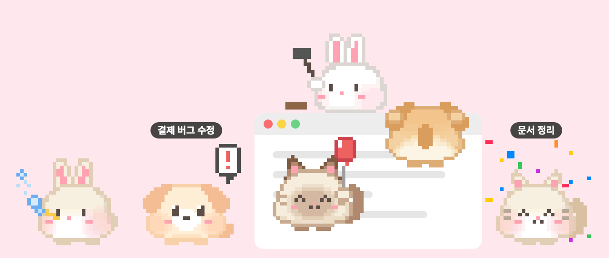
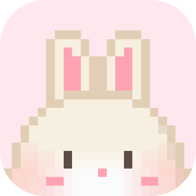
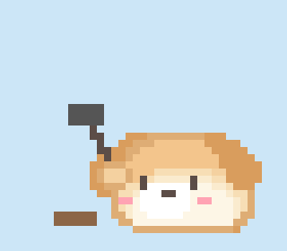
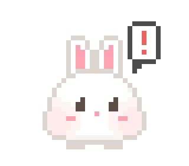
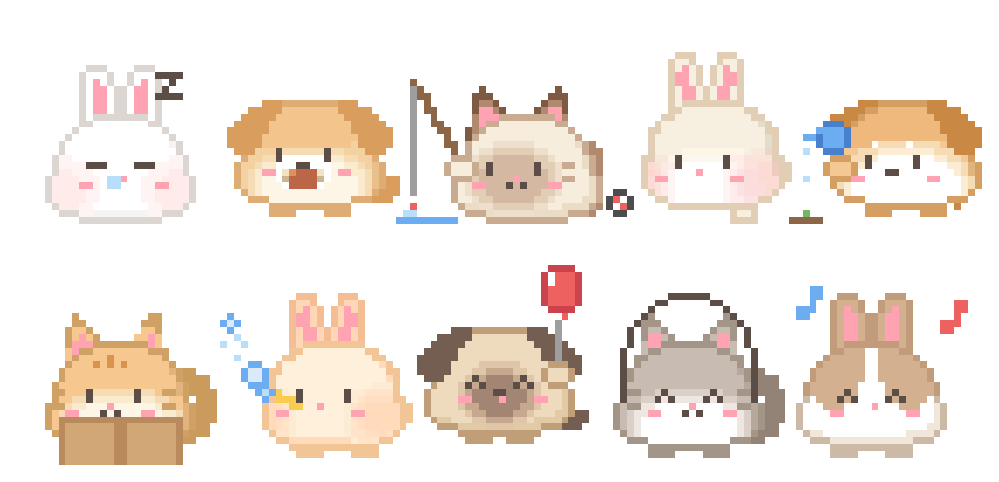
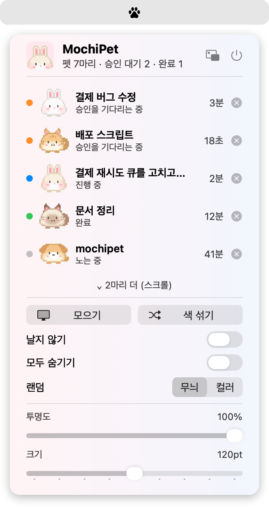
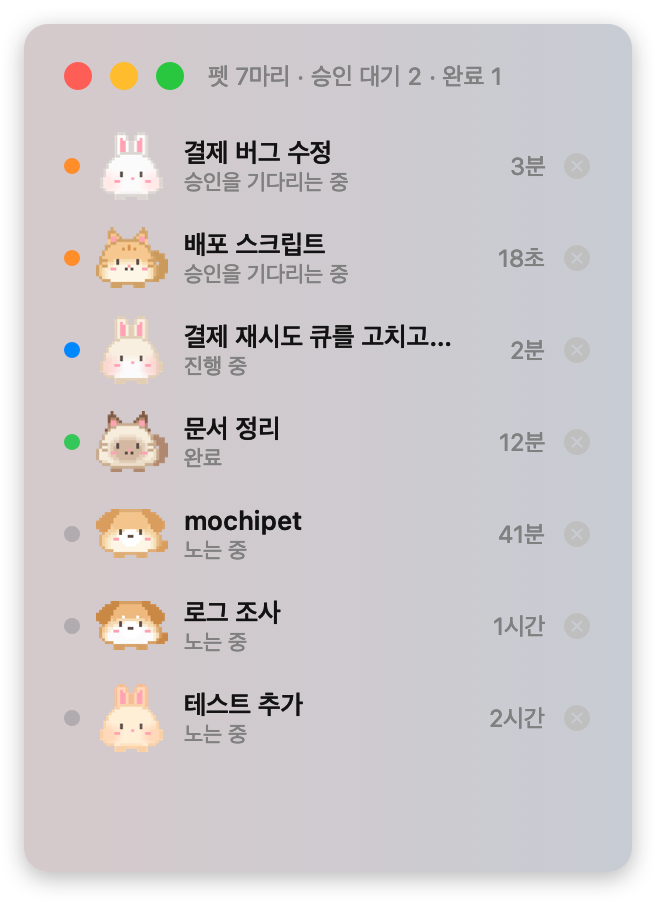
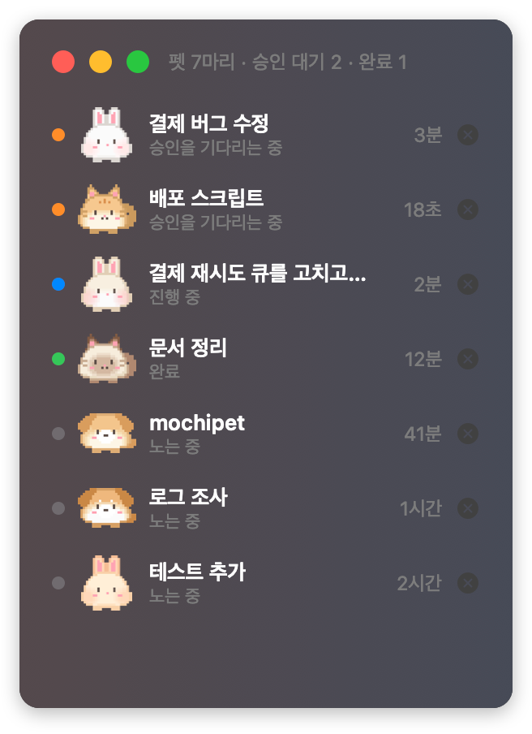
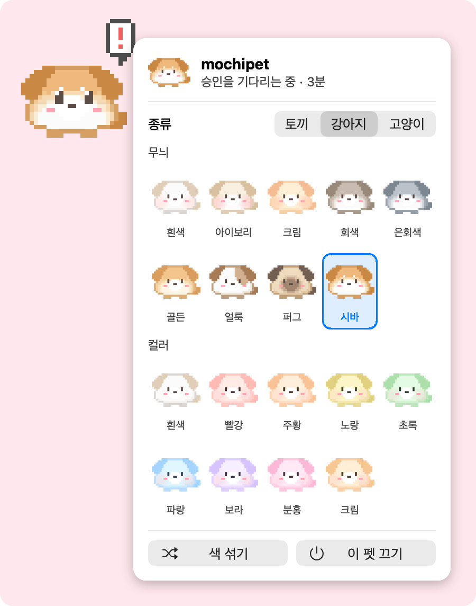
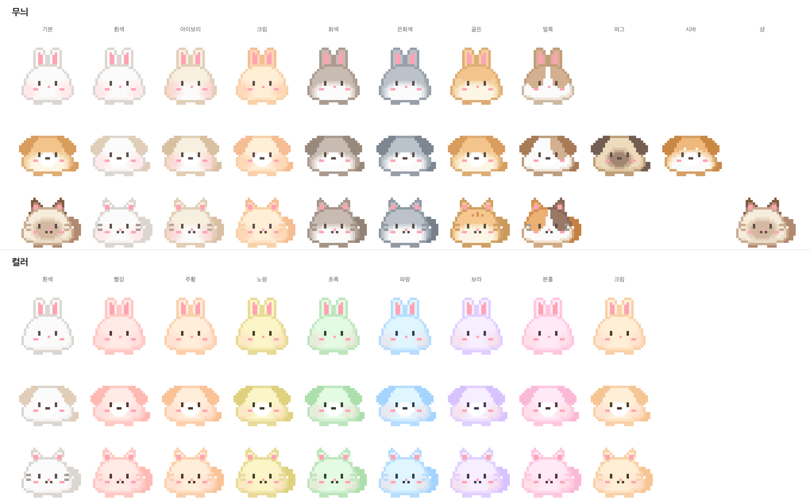

<div align="center">
  
  <h1>&nbsp;MochiPet</h1>
  <p>Claude Code 세션이 진행 중인지, 승인을 기다리는지, 완료했는지를<br>몸짓으로 알려 주는 macOS 바탕화면 펫입니다.</p>
  <p>
    
    
    
    
  </p>
  <p><a href="README.md">English</a> · <b>한국어</b></p>
</div>

---

## 지원하는 AI 도구

- **Claude Code**: 터미널에서 띄운 `claude` CLI. 펫을 누르면 그 세션의 터미널 창이 앞으로 옵니다. (손쉬운 사용 권한 필요) 이름표에 `/rename` 으로 붙인 세션 이름이 나옵니다.
- **Claude Desktop**: Code 탭의 세션. 펫을 누르면 그 세션이 열리고, 이름표에 세션 이름이 나옵니다.

## 기능

- **세션 상태 알림**: 진행 중에는 망치질하고, 권한 승인을 기다릴 때는 `!` 를 띄우고, 턴이 끝나면 꽃가루와 함께 뜁니다.
- **세션으로 바로 가기**: 펫을 누르면 그 세션으로 전환됩니다.
- **세션마다 한 마리**: `/pet on` 을 한 세션마다 펫이 생기고, 머리 위에 이름표가 붙습니다.
- **세 종류의 도트 펫**: 토끼, 강아지, 고양이에 무늬와 컬러를 입힙니다.
- **혼자 놀기**: 할 일이 없으면 걷고, 자고, 낚시하고, 풍선을 탑니다.
- **메뉴 막대 조절**: 투명도와 크기를 바꾸고, 날지 않게 하거나 모두 숨깁니다.
- **띄워 두는 세션 목록**: 메뉴 막대의 세션 목록을 작은 창으로 띄워 둡니다. 다른 창과 전체화면 위에 보입니다.

## 설치

macOS 전용입니다. 아래가 필요합니다.

- Xcode Command Line Tools (`xcode-select --install`)
- Claude Code 또는 Claude Desktop

터미널에서 아래 명령을 실행합니다.

```bash
claude plugin install mochipet --marketplace lyeongl/mochipet
```

- 새로 여는 세션부터 `/pet on` 을 쓸 수 있습니다. 처음 켤 때는 펫 앱을 빌드하느라 10~20초쯤 걸립니다.
- 훅 5개와 `/pet` 스킬이 플러그인에 들어 있습니다. `~/.claude/settings.json` 은 고치지 않습니다.

### 업데이트

```bash
claude plugin update mochipet@mochipet
```

### 삭제

```bash
claude plugin uninstall mochipet@mochipet
```

- 펫의 상태와 설정(투명도, 크기 등)은 플러그인의 데이터 폴더에 있어서 함께 지워집니다.
- 마켓 등록까지 지우려면 `claude plugin marketplace remove mochipet` 을 실행합니다.

### 1.x 를 썼다면

1.x 는 `git clone` 과 `./install.sh` 로 설치했습니다. 2.0 을 설치하기 전에, 받아 둔 폴더에서 아래 명령으로 예전 설치를 지웁니다. 두 가지가 같이 있으면 훅이 두 번 걸립니다.

```bash
./install.sh uninstall
```

## 사용법

Claude 세션에서 아래 명령을 입력합니다.

| 명령 | 하는 일 |
|---|---|
| `/pet on` | 이 세션의 펫을 켭니다. 종류와 색은 다른 펫과 덜 겹치게 무작위로 정합니다 |
| `/pet on 세션 이름` | 이름표를 정해서 켭니다. 이름을 주지 않으면 세션 이름(터미널에서는 `/rename` 으로 붙인 이름)이 이름표가 됩니다 |
| `/pet kind dog` | 펫 종류를 바꿉니다. `bunny`(토끼), `dog`(강아지), `cat`(고양이)이 있습니다 |
| `/pet color` | 색을 다시 무작위로 뽑습니다 |
| `/pet color pink` | 색을 이름(아래 색 그림 참고)이나 0~360 숫자(색상환 각도)로 정합니다 |
| `/pet color default` | 그 종류의 기본 색으로 돌아갑니다 |
| `/pet name 새 세션 이름` | 이름표를 바꿉니다 |
| `/pet off` | 펫을 끕니다 |


## 스크린샷

<table align="center">
  <tr>
    <td align="center" colspan="2" width="33%"></td>
    <td align="center" colspan="2" width="33%"></td>
    <td align="center" colspan="2" width="33%"></td>
  </tr>
  <tr>
    <th align="center" colspan="2">진행 중</th>
    <th align="center" colspan="2">승인 대기</th>
    <th align="center" colspan="2">완료</th>
  </tr>
  <tr>
    <td align="center" colspan="6"></td>
  </tr>
  <tr>
    <th align="center" colspan="6">노는 중</th>
  </tr>
  <tr>
    <td align="center" colspan="2"></td>
    <td align="center" colspan="2"></td>
    <td align="center" colspan="2"></td>
  </tr>
  <tr>
    <th align="center" colspan="2">메뉴 막대</th>
    <th align="center" colspan="2">띄운 창 (밝은 모드)</th>
    <th align="center" colspan="2">띄운 창 (어두운 모드)</th>
  </tr>
  <tr>
    <td align="center" colspan="6"></td>
  </tr>
  <tr>
    <th align="center" colspan="6">펫 우클릭 메뉴</th>
  </tr>
</table>

### 색



## 라이선스

[MIT](LICENSE)
