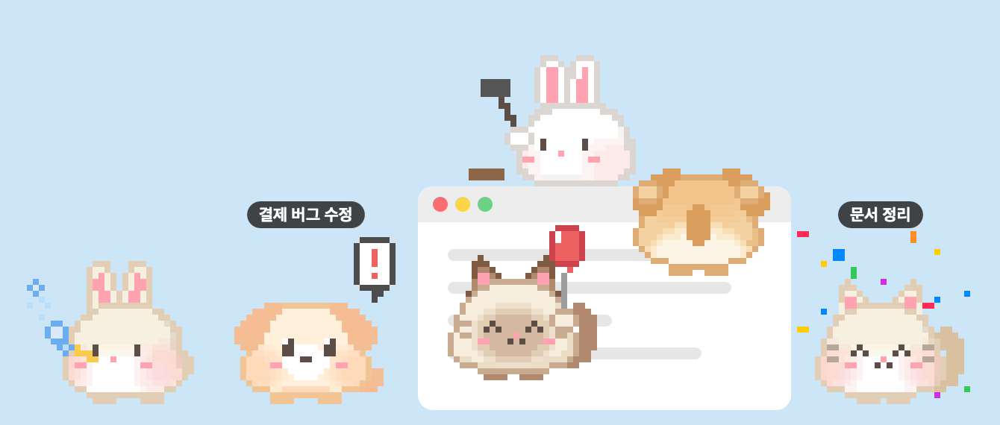
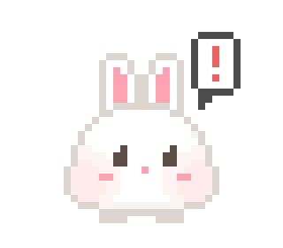
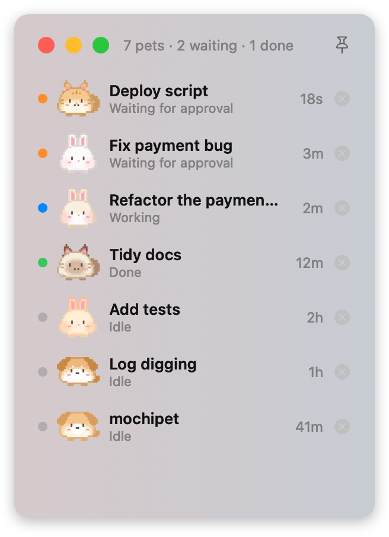
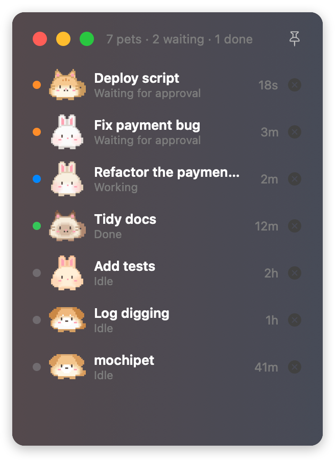

<div align="center">
  
  <h1>&nbsp;MochiPet</h1>
  <p>A macOS desktop pet that shows you whether each Claude Code session<br>is working, waiting for approval, or done.</p>
  <p>
    
    
    
    
  </p>
  <p><b>English</b> · <a href="README.ko.md">한국어</a></p>
</div>

---

## Supported AI tools

- **Claude Code**: the `claude` CLI in a terminal. Click the pet to bring up that session's terminal window. (Requires the Accessibility permission.) The name tag shows the session name you set with `/rename`.
- **Claude Desktop**: sessions in the Code tab. Click the pet to open that session. The name tag shows the session name.

## Features

- **Session state at a glance**: the pet hammers while Claude is working, shows a `!` while a permission request is pending, and jumps under falling confetti when the turn ends.
- **Jump to the session**: click the pet to switch to its session.
- **One pet per session**: each session where you run `/pet on` gets a pet with a name tag above its head.
- **Three pixel-art pets**: a bunny, a dog, and a cat, each in several patterns and colors.
- **Plays on its own**: when idle, it walks, naps, fishes, rides a balloon, and more.
- **Menu bar controls**: change opacity and size, keep pets on the ground, or hide them all.
- **Auto-on**: turn on "Auto-on" in the menu bar, and a pet appears when you send the first prompt in a session, without `/pet on`. A session you turned off with `/pet off` stays off.
- **Floating session list**: pop the session list out of the menu bar into a small window that stays above other windows, including full-screen ones.

## Install

macOS only. Requirements:

- Xcode Command Line Tools (`xcode-select --install`)
- Claude Code or Claude Desktop

Run the command below in a terminal.

```bash
claude plugin install mochipet --marketplace lyeongl/mochipet
```

- `/pet on` works from the next session you open. The first run takes 10–20 seconds while the pet app builds.
- The plugin includes five hooks and the `/pet` skill. Your `~/.claude/settings.json` is left untouched.

### Update

```bash
claude plugin update mochipet@mochipet
```

After updating, follow these steps.

1. Quit Claude Desktop completely (`Cmd+Q`) and open it again. In a terminal, exit `claude` and run it again. Sessions that were already open keep using the old version until they restart.
2. Run `/pet on` in any session. The pet app starts in the new version and a paw icon appears in the menu bar.
3. To use Auto-on, click the paw icon and turn on "Auto-on". The switch stays on, and from the next update you can skip step 2: the pet turns on at the first prompt.

### Uninstall

```bash
claude plugin uninstall mochipet@mochipet
```

- Pet state and settings (opacity, size, and so on) live in the plugin's data folder, so they are removed too.
- To also remove the marketplace entry, run `claude plugin marketplace remove mochipet`.

### Upgrading from 1.x

1.x was installed with `git clone` and `./install.sh`. Before installing 2.0, remove the old install by running the command below in the folder you cloned. With both installed, every hook runs twice.

```bash
./install.sh uninstall
```

## Usage

Type these in a Claude session.

| Command | What it does |
|---|---|
| `/pet on` | Turns on this session's pet. Kind and color are picked at random, favoring ones no other pet is using |
| `/pet on session name` | Turns it on with a name tag. Without a name, the session name (in a terminal, the name you set with `/rename`) becomes the name tag |
| `/pet kind dog` | Changes the kind: `bunny`, `dog`, or `cat` |
| `/pet color` | Picks a new color at random |
| `/pet color pink` | Sets the color by name (see the chart below), or by hue angle, from 0 to 360 |
| `/pet color default` | Resets to that kind's default color |
| `/pet name new session name` | Changes the name tag |
| `/pet off` | Turns the pet off |

## Screenshots

<table align="center">
  <tr>
    <td align="center" colspan="2" width="33%"></td>
    <td align="center" colspan="2" width="33%"></td>
    <td align="center" colspan="2" width="33%"></td>
  </tr>
  <tr>
    <th align="center" colspan="2">Working</th>
    <th align="center" colspan="2">Waiting for approval</th>
    <th align="center" colspan="2">Done</th>
  </tr>
  <tr>
    <td align="center" colspan="6"></td>
  </tr>
  <tr>
    <th align="center" colspan="6">Idle</th>
  </tr>
  <tr>
    <td align="center" colspan="2"></td>
    <td align="center" colspan="2"></td>
    <td align="center" colspan="2"></td>
  </tr>
  <tr>
    <th align="center" colspan="2">Menu bar</th>
    <th align="center" colspan="2">Floating list (light)</th>
    <th align="center" colspan="2">Floating list (dark)</th>
  </tr>
  <tr>
    <td align="center" colspan="6"></td>
  </tr>
  <tr>
    <th align="center" colspan="6">Right-click on a pet</th>
  </tr>
</table>

### Colors


## License

[MIT](LICENSE)
