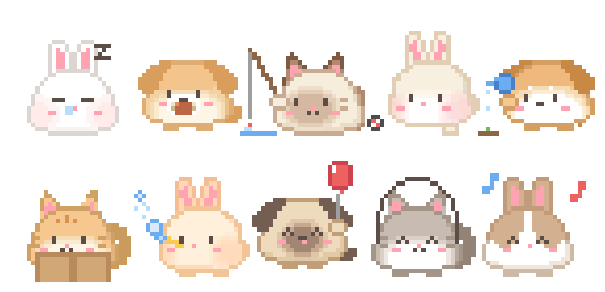
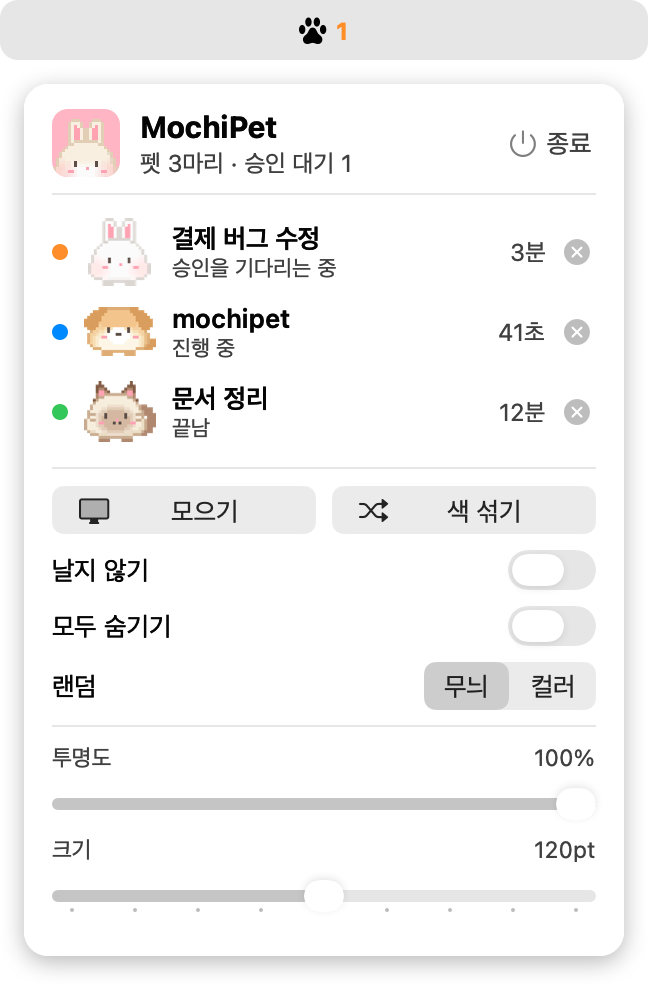
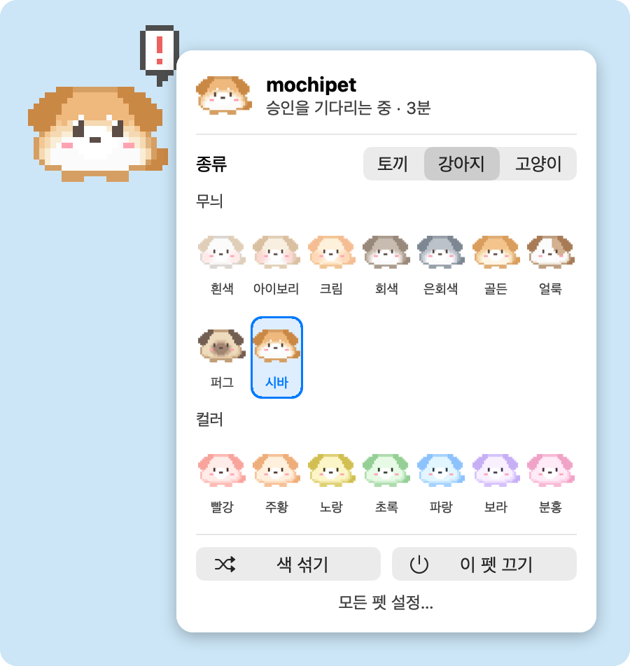
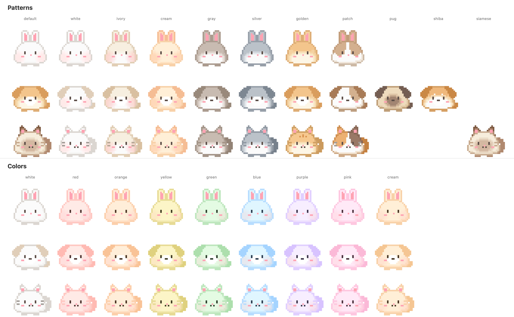

<div align="center">
  
  <h1>&nbsp;MochiPet</h1>
  <p>Claude Code 세션이 일하는 중인지, 승인을 기다리는지, 끝났는지를<br>몸짓으로 알려 주는 macOS 바탕화면 펫입니다.</p>
  <p>
    
    
    
    
  </p>
  <p><b>한국어</b> · <a href="README.en.md">English</a></p>
</div>

---

## 지원하는 AI 도구

- **Claude Code**: 터미널에서 띄운 `claude` CLI. 펫을 누르면 그 터미널 앱으로 전환됩니다.
- **Claude 데스크탑**: Code 탭의 세션. 펫을 누르면 그 세션이 열리고, 이름표에 세션 제목이 나옵니다.

## 기능

- **세션 상태 알림**: 진행 중에는 망치질하고, 권한 승인을 기다릴 때는 `!` 를 띄우고, 턴이 끝나면 꽃가루와 함께 뜁니다.
- **세션으로 바로 가기**: 펫을 누르면 그 세션으로 전환됩니다.
- **세션마다 한 마리**: `/pet on` 을 한 세션마다 펫이 생기고, 머리 위에 이름표가 붙습니다.
- **세 종류의 도트 펫**: 토끼, 강아지, 고양이에 무늬와 컬러를 입힙니다.
- **혼자 노는 펫**: 할 일이 없으면 걷고, 자고, 낚시하고, 풍선을 탑니다. 동작이 40가지가 넘습니다.
- **메뉴 막대 조절**: 투명도와 크기를 바꾸고, 날지 않게 하거나 모두 숨깁니다.

## 설치

macOS 전용입니다. 아래 두 가지가 필요합니다.

- Xcode Command Line Tools (`xcode-select --install`)
- Claude 데스크탑

설치 방법은 두 가지입니다. 하나만 쓰세요. 둘 다 쓰면 훅이 두 번 걸립니다.

### 방법 1. 플러그인

터미널에서 아래 명령을 실행합니다. Claude Code 2.1.275 이상이 필요합니다.

```bash
claude plugin install mochipet --marketplace lyeongl/mochipet
```

- 새로 여는 세션부터 `/pet on` 을 쓸 수 있습니다. 처음 켤 때는 펫 앱을 빌드하느라 10~20초쯤 걸립니다.
- 훅 5개와 `/pet` 스킬이 플러그인에 들어 있습니다. `~/.claude/settings.json` 의 `hooks` 는 고치지 않습니다.
- 이미 방법 2 로 설치하셨다면 `./install.sh uninstall` 을 먼저 실행해 주세요.

업데이트와 삭제는 아래 명령으로 합니다.

```bash
claude plugin update mochipet@mochipet
```

```bash
claude plugin uninstall mochipet@mochipet
```

### 방법 2. git clone

`claude` 명령이 없을 때 이 방법을 씁니다.

```bash
git clone https://github.com/lyeongl/mochipet.git
```

```bash
cd mochipet && ./install.sh
```

`install.sh` 는 다음 일을 합니다.

1. `MochiPet.app` 을 이 폴더 안에 빌드합니다.
2. `/pet` 스킬을 `~/.claude/skills/pet/` 에 넣습니다.
3. `~/.claude/settings.json` 의 `hooks` 에 훅 5개를 넣습니다.
   - 이미 있던 훅과 설정은 그대로 둡니다.
   - 고치기 전 파일을 `settings.json.pet-backup` 으로 남깁니다.

훅은 이 폴더의 실행 파일을 가리킵니다. 폴더를 옮기셨다면 `./install.sh` 를 다시 실행해 주세요.

지우실 때는 아래 명령을 사용합니다. 이 펫의 훅, 스킬, 세션 상태, 백업 파일만 지웁니다.

```bash
./install.sh uninstall
```

## 사용법

Claude 세션에서 아래 명령을 입력합니다.

| 명령 | 하는 일 |
|---|---|
| `/pet on` | 이 세션의 펫을 켭니다. 종류와 색은 다른 펫과 덜 겹치게 무작위로 정합니다 |
| `/pet on 세션명` | 이름표를 정해서 켭니다. 이름을 주지 않으면 Claude 데스크탑의 세션 제목이 이름표가 됩니다 |
| `/pet kind dog` | 펫 종류를 바꿉니다. `bunny`(도트 토끼), `dog`(도트 강아지), `cat`(도트 고양이)이 있습니다 |
| `/pet color` | 색을 다시 무작위로 뽑습니다 |
| `/pet color pink` | 색을 정합니다. 쓸 수 있는 이름은 아래 [펫 색상](#펫-색상)에 있습니다 |
| `/pet color default` | 그 종류의 기본 색으로 돌아갑니다 |
| `/pet name 새 세션명` | 이름표를 바꿉니다 |
| `/pet off` | 펫을 끕니다 |


## 스크린샷

<table>
  <tr>
    <td align="center" colspan="2" width="33%"></td>
    <td align="center" colspan="2" width="33%"></td>
    <td align="center" colspan="2" width="33%"></td>
  </tr>
  <tr>
    <th align="center" colspan="2">진행 중</th>
    <th align="center" colspan="2">승인 대기</th>
    <th align="center" colspan="2">완료</th>
  </tr>
  <tr>
    <td align="center" colspan="6"></td>
  </tr>
  <tr>
    <th align="center" colspan="6">평소</th>
  </tr>
  <tr>
    <td align="center" colspan="3"></td>
    <td align="center" colspan="3"></td>
  </tr>
  <tr>
    <th align="center" colspan="3">메뉴 막대</th>
    <th align="center" colspan="3">펫 우클릭 메뉴</th>
  </tr>
</table>

### 색상



- 색은 `/pet color <이름>` 을 입력하거나 펫을 우클릭해서 고릅니다. 이름 대신 0~360 숫자를 주면 그 색상환 각도의 색이 됩니다.

## 라이선스

[MIT](LICENSE)
