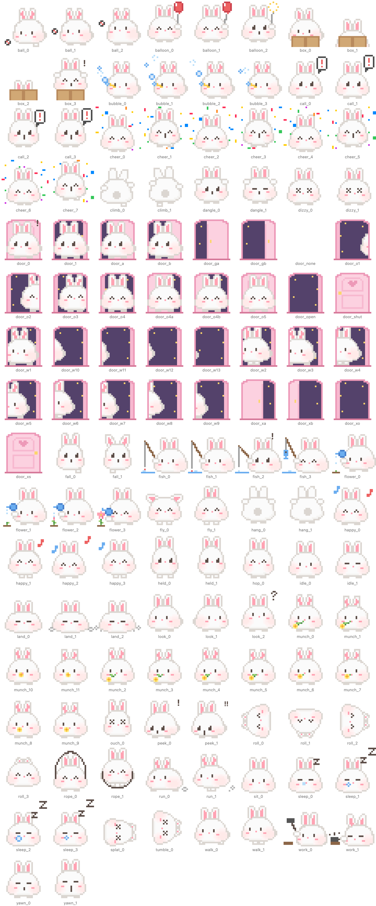

# MochiPet

한국어 | [English](README.en.md)


Claude 데스크탑의 Code 세션용 바탕화면 펫입니다.  
`/pet on` 으로 펫을 만들어 보세요!

## 세션 상태를 펫이 알려줍니다

세션 창을 보고 있지 않아도 펫만 보면 Claude 가 지금 무엇을 하는지 알 수 있습니다.

| 진행 중 | 승인 대기 | 완료 |
|:---:|:---:|:---:|
|  |  |  |
| **앉아서 망치질합니다** | **`!` 를 띄우고 부릅니다** | **꽃가루와 함께 뜁니다** |
| 프롬프트를 보내면 시작해서<br>턴이 끝날 때까지 합니다 | 권한 승인을 기다리는 동안 계속 부릅니다.<br>승인하면 다시 망치질합니다 | 턴이 끝나면 뜁니다. 펫을 누르거나<br>그 세션을 열어 보면 평소로 돌아갑니다 |

그 외에는 걷고, 자고, 먹으면서 혼자 놉니다. 펫을 누르면 그 세션이 Claude 데스크탑에서 열립니다.

## 설치

macOS 전용입니다. 아래 두 가지가 필요합니다.

- Xcode Command Line Tools (`xcode-select --install`)
- Claude 데스크탑

```bash
git clone https://github.com/lyeongl/mochipet.git
```

```bash
cd mochipet && ./install.sh
```

`install.sh` 는 다음 일을 합니다.

1. `MochiPet.app` 을 이 폴더 안에 빌드합니다.
2. `/pet` 스킬을 `~/.claude/skills/pet/` 에 넣습니다.
3. `~/.claude/settings.json` 의 `hooks` 에 훅 5개를 넣습니다.
   - 이미 있던 훅과 설정은 그대로 둡니다.
   - 고치기 전 파일을 `settings.json.pet-backup` 으로 남깁니다.

훅은 이 폴더의 실행 파일을 가리킵니다. 폴더를 옮기셨다면 `./install.sh` 를 다시 실행해 주세요.

지우실 때는 아래 명령을 사용합니다. 이 펫의 훅, 스킬, 세션 상태, 백업 파일만 지웁니다.

```bash
./install.sh uninstall
```

## 사용법

### 명령

Claude 세션에서 아래 명령을 입력합니다.

| 명령 | 하는 일 |
|---|---|
| `/pet on` | 이 세션의 펫을 켭니다. 종류와 색은 다른 펫과 덜 겹치게 무작위로 정합니다 |
| `/pet on 결제 버그` | 이름표를 정해서 켭니다. 이름을 주지 않으면 Claude 데스크탑의 세션 제목이 이름표가 됩니다 |
| `/pet kind dog` | 펫 종류를 바꿉니다. `bunny`(도트 토끼), `dog`(도트 강아지), `cat`(도트 고양이)이 있습니다 |
| `/pet color` | 색을 다시 무작위로 뽑습니다 |
| `/pet color pink` | 색을 정합니다. 쓸 수 있는 이름은 아래 [펫 색상](#펫-색상)에 있습니다 |
| `/pet color default` | 그 종류의 기본 색으로 돌아갑니다 |
| `/pet name 새 이름` | 이름표를 바꿉니다 |
| `/pet off` | 펫을 끕니다 |

### 메뉴바 아이콘

펫이 떠 있는 동안 메뉴바에 발바닥 아이콘이 생깁니다. 여기서 모든 펫을 한꺼번에 바꿉니다.


| 항목 | 하는 일 |
|---|---|
| 투명도 | 30~100% 로 조절합니다 |
| 크기 | 60~180pt 로 조절합니다. 도트가 고르게 보이는 크기에 맞춰집니다 |
| 속도 | 느리게, 보통, 빠르게 세 단계로 조절합니다 |
| 랜덤 | 무늬 랜덤, 컬러 랜덤 중에서 고릅니다. 색을 무작위로 뽑을 때 무늬에서 뽑을지 컬러에서 뽑을지 정합니다 |
| 이 화면으로 모으기 | 떠 있는 펫 전부를 메뉴를 연 화면으로 옮깁니다 |
| 날지 않기 | 펫이 화면 바닥에만 있습니다. 날거나 풍선을 타거나 창 위로 올라가지 않습니다. 다시 누르면 돌아옵니다 |
| 모두 색 섞기 | 떠 있는 펫 전부의 색을 다시 무작위로 뽑습니다. 종류는 그대로 둡니다.<br>안 나온 색을 먼저 뽑고, 다 나온 뒤에는 겹치게 뽑습니다 |
| 모두 숨기기 | 펫을 숨기고 멈춥니다. 다시 누르면 돌아옵니다 |
| 종료 | 펫 앱을 끕니다. 켜 둔 펫은 다음에 `/pet on` 을 할 때 함께 돌아옵니다 |

## 펫 색상


- 색은 `/pet color <이름>` 이나 펫 우클릭 메뉴의 "색" 에서 고릅니다. 이름 대신 0~360 숫자를 주면 그 색상환 각도의 색이 됩니다.

## 펫 종류




직접 그린 그림을 쓰시려면 아래 순서로 하시면 됩니다.

1. 이 폴더에 `sprites/<종류>/` 를 만듭니다.
2. 위 그림에 적힌 프레임 이름으로 정사각형 PNG 를 넣습니다 (`idle_0.png`, `walk_0.png` …).
3. `/pet kind <종류>` 를 입력합니다.

- 없는 프레임은 `idle_0.png` 로 대신합니다.
- 그림은 왼쪽을 보게 그려 주세요.
